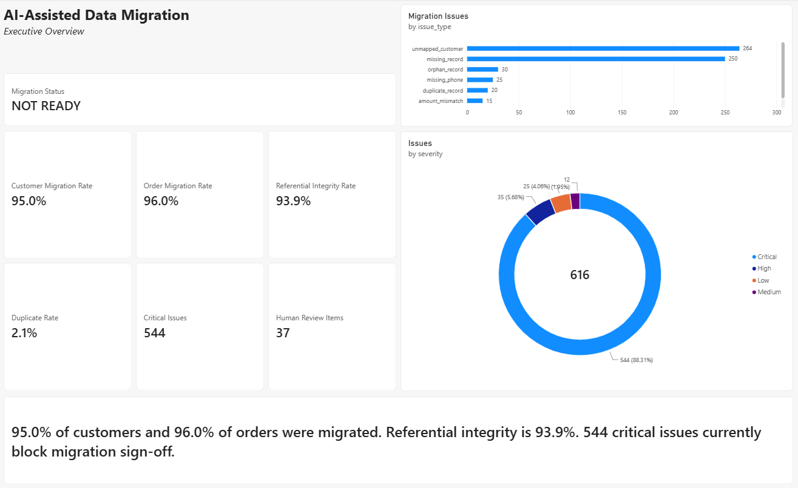
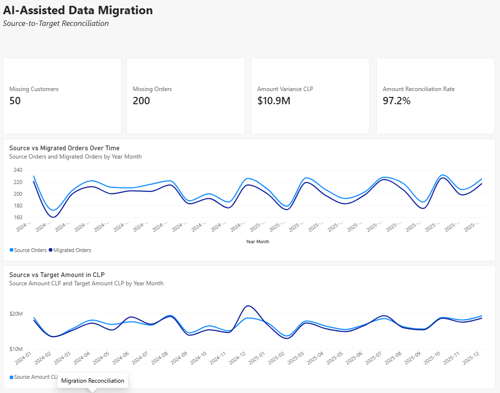
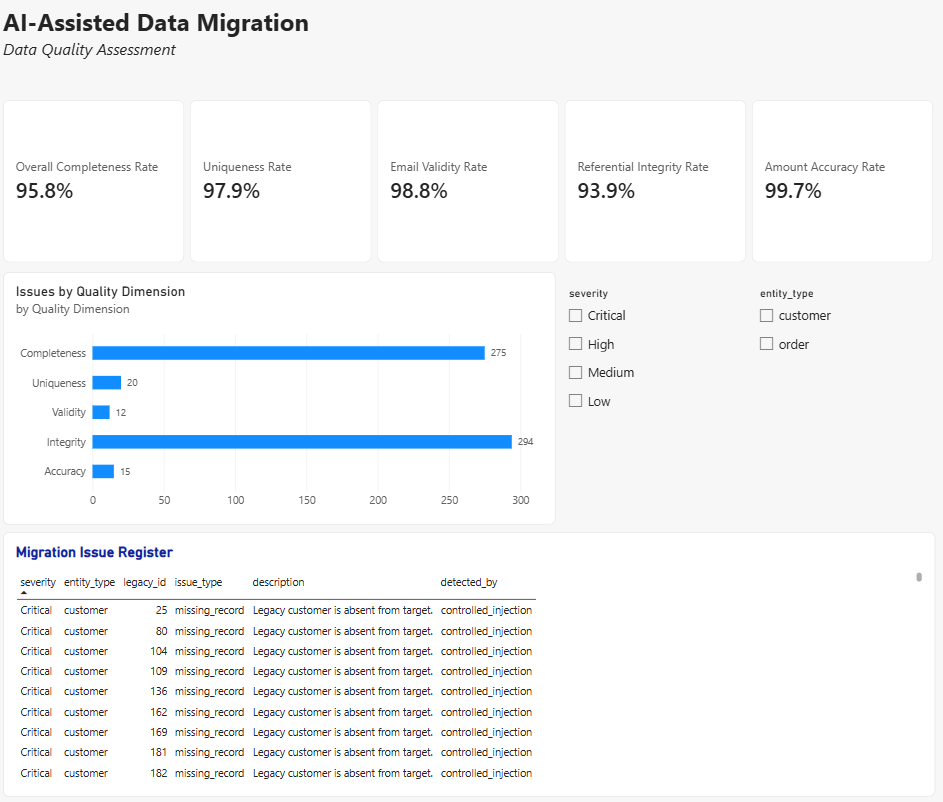
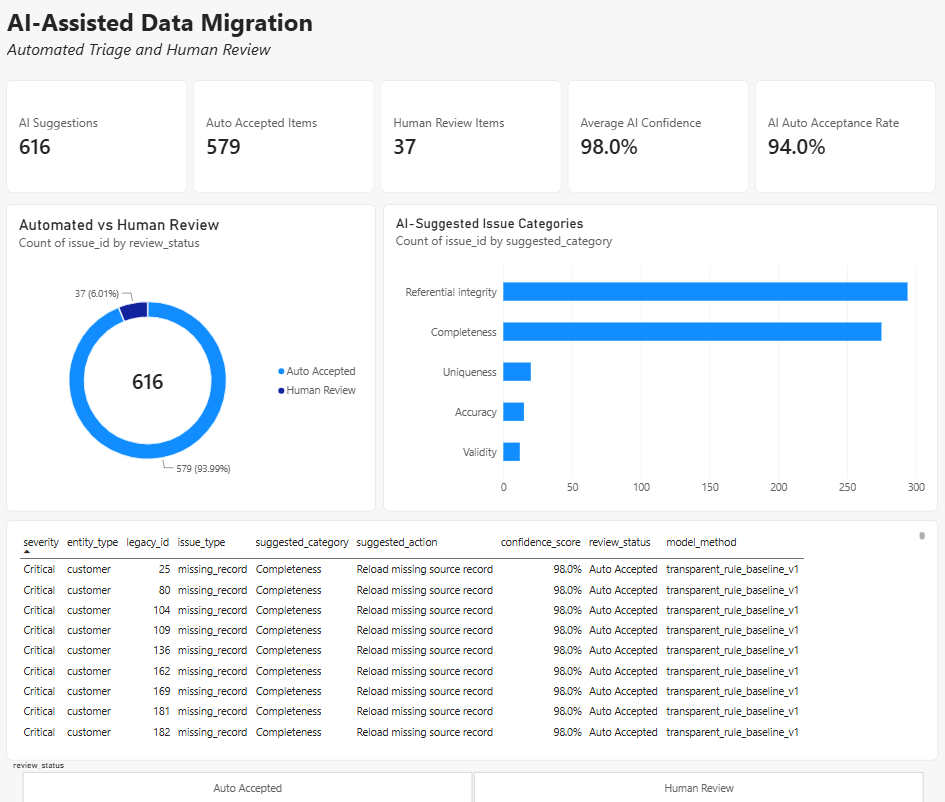
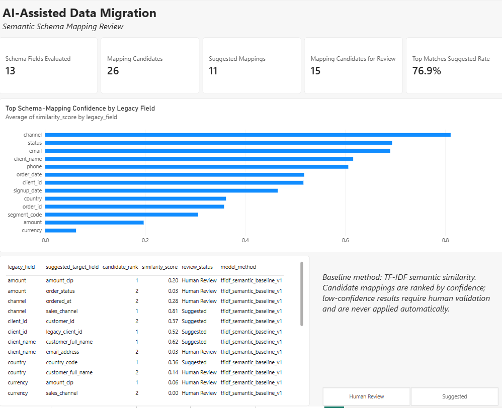
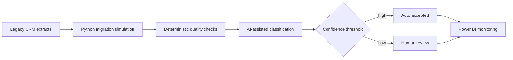

# AI-Assisted Data Migration Quality Dashboard

An end-to-end analytics portfolio project that uses **Python, SQL, Power Query, DAX, and Power BI** to validate a CRM migration and route ambiguous cases through an auditable AI-assisted review workflow.

The project answers one practical question: **is the migrated data reliable enough for business reporting?**



## Business problem

A company is migrating customer and order data from a legacy CRM to a new analytics platform. Record counts alone cannot prove that the migration succeeded: records may be missing or duplicated, foreign keys may be broken, and business values may change during transformation.

The dashboard helps migration and operations teams:

- reconcile source and target customer and order records;
- identify completeness, uniqueness, validity, integrity, and accuracy issues;
- assess whether critical defects block migration sign-off;
- inspect AI-generated remediation suggestions with confidence scores;
- send low-confidence recommendations to human review;
- evaluate suggested source-to-target schema mappings.

## Key results

| Metric | Result |
|---|---:|
| Customer migration rate | 95.0% |
| Order migration rate | 96.0% |
| Amount reconciliation rate | 97.2% |
| Referential integrity rate | 93.9% |
| Total migration issues | 616 |
| Critical issues | 544 |
| AI suggestions auto-accepted | 579 (94.0%) |
| Items routed to human review | 37 (6.0%) |

The migration is classified as **NOT READY** because unresolved critical completeness and referential-integrity issues remain. The largest issue groups are 264 orders linked to unmigrated customers and 250 missing records.

## Report pages

### 1. Executive Overview

Headline migration KPIs, readiness status, issue severity, and an executive summary for rapid sign-off decisions.


### 2. Migration Reconciliation

Source-to-target comparison of customers, orders, and normalized order amounts over time.



### 3. Data Quality

Quality assessment across completeness, uniqueness, validity, referential integrity, and accuracy, supported by a detailed issue register.



### 4. AI Review Queue

Transparent issue classification, recommended remediation actions, confidence scores, and separation of automatically accepted suggestions from cases requiring human validation.



### 5. Schema Mapping Review

Ranked source-to-target field candidates generated with semantic similarity. Low-confidence mappings remain explicitly marked for human review.



## AI-assisted workflow

AI assistance is used only where recommendations or semantic matching add value. Deterministic reconciliation remains in SQL, Python, Power Query, and DAX.



The reproducible baseline has two components:

1. **Issue review queue:** transparent rules assign each defect a quality category, recommended action, confidence score, and review status.
2. **Schema mapping review:** TF-IDF and cosine similarity rank two candidate target fields for each legacy field.

This baseline requires no API key, stores every result in CSV, and keeps the method and confidence visible for audit. It demonstrates a production-safe principle: **AI proposes; deterministic checks verify; people approve ambiguous cases.**

## Data model

The report combines source and target transaction tables with focused quality-control tables:

- `legacy_customers` and `legacy_orders` — source-system extracts;
- `target_customers` and `target_orders` — migrated records;
- `migration_issues` — row-level quality exceptions;
- `ai_review_queue` — suggested classifications and actions;
- `schema_mapping_review` — ranked field-mapping candidates;
- `dim_date` — shared reporting calendar.

The synthetic dataset contains 1,000 source customers and 5,000 source orders. Controlled defects include missing and duplicate records, invalid emails, missing phone numbers, orphan orders, unmapped customers, and amount mismatches. No real personal or transaction data is used.

## Technology

- **Python:** reproducible data generation, migration simulation, issue classification, and semantic field matching
- **SQL (PostgreSQL):** schema definition and independent data-quality checks
- **Power Query:** ingestion, type handling, transformations, and model preparation
- **DAX:** reconciliation, quality, readiness, and AI-review measures
- **Power BI:** interactive analysis and migration decision support
- **Git/GitHub:** versioned, reproducible project delivery

## Repository structure

```text
data/
  raw/                  Legacy source extracts
  processed/            Migrated tables, issues, and AI outputs
docs/
  screenshots/          Exported Power BI report pages
  data_dictionary.md    Table and field definitions
  project_scope.md      Business scope and acceptance criteria
powerbi/
  ai-assisted-data-migration.pbix
sql/
  01_create_tables.sql
  02_quality_checks.sql
src/
  generate_data.py
  build_ai_review_queue.py
requirements.txt
```

## Run locally

```bash
python -m venv .venv
```

Activate the environment:

```bash
# macOS / Linux
source .venv/bin/activate

# Windows PowerShell
.venv\Scripts\Activate.ps1
```

Install dependencies and regenerate the complete dataset:

```bash
pip install -r requirements.txt
python src/generate_data.py
python src/build_ai_review_queue.py
```

Open `powerbi/ai-assisted-data-migration.pbix` in Power BI Desktop. If the repository is stored in a different directory, update the CSV source paths in **Transform data → Data source settings**.

## Validation

- The generator uses a fixed seed, so defect counts are reproducible.
- `sql/02_quality_checks.sql` independently validates the principal migration defects.
- AI outputs include the method, confidence score, and review status.
- Low-confidence suggestions are never silently applied.
- Detailed issue tables preserve traceability back to affected legacy records.

## Further documentation

- [Project scope](docs/project_scope.md)
- [Data dictionary](docs/data_dictionary.md)
- [Power BI model notes](powerbi/README.md)

---

Built as a portfolio project to demonstrate the transition from full-stack development and database migration work into data analytics: combining technical implementation with business-facing analysis, data visualization, and responsible AI-assisted decision support.

